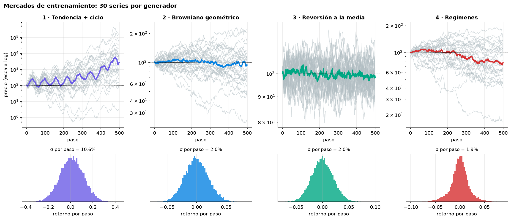
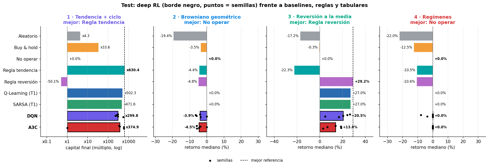
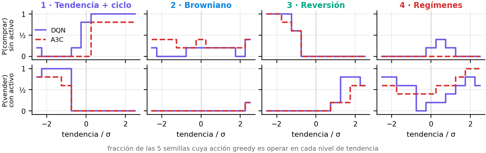
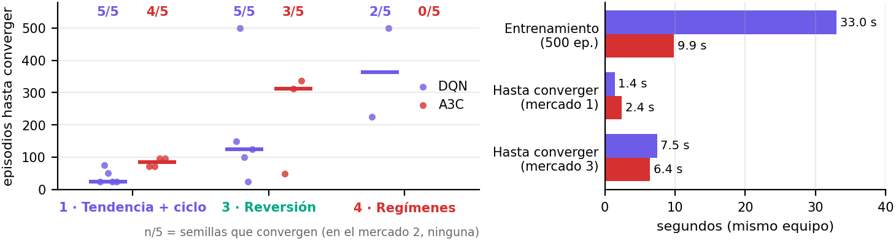
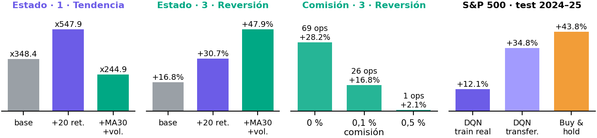
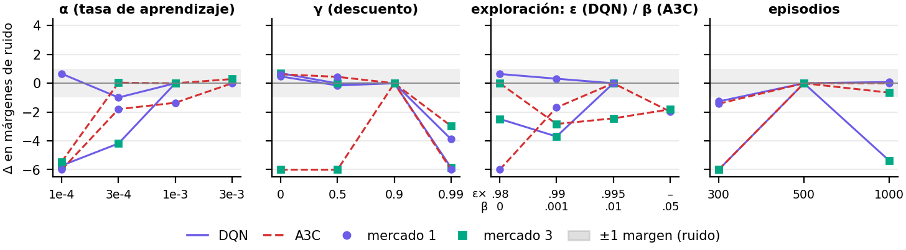

<div align="center">

# Deep RL Trading Agents

**DQN y A3C para invertir en un único activo sobre cuatro mercados sintéticos y el S&P 500**


Máster MIAX · Aprendizaje por Refuerzo · Taller 2 · Noviembre 2026<br>
Óscar Romero Quincoces · Fernando Dapena Tauste · Daniel García López

[**Informe PDF**](results/informe.pdf) · [**Presentación**](results/presentacion/presentacion.pdf) · [**Comparativa final**](notebooks/04_comparativa.ipynb) · [Decisiones](docs/DECISIONES.md) · [Taller 1 (tabular)](https://github.com/Romequinco/rl-trading-agents)

</div>

---

## En una frase

> Con el estado del enunciado (`tendencia`, `posición`), **DQN y A3C aprenden la estrategia esperada donde hay señal, pero
> no superan a reglas de un umbral ni a los tabulares del Taller 1**. Empatan entre sí, y lo que de verdad mejora el
> resultado es **enriquecer el estado**, no cambiar de algoritmo.

<p align="center"></p>
<p align="center"><sub>Los cuatro mercados: 30 series de 500 precios por generador e histograma de retornos por paso.</sub></p>

## Resultados de un vistazo

Mediana del retorno en las **200 series de test** (DQN y A3C: mediana de 5 semillas). En negrita, el mejor de cada mercado.

| Agente | 1 · Tendencia + ciclo | 2 · Browniano | 3 · Reversión | 4 · Regímenes |
|---|---:|---:|---:|---:|
| Aleatorio | x4,3 | −19,4 % | −17,2 % | −22,0 % |
| Buy & hold | x33,6 | −3,5 % | −0,3 % | −12,5 % |
| No operar | 0 % | **0 %** | 0 % | **0 %** |
| Mejor regla de un umbral | **x630,4** | −4,4 % | **+29,2 %** | −10,5 % |
| Q-Learning (Taller 1) | x502,3 | **0 %** | +27,0 % | **0 %** |
| **DQN** | x299,8 | −3,9 % | +20,5 % | **0 %** |
| **A3C** | x374,9 | −4,5 % | +13,8 % | **0 %** |

<p align="center"></p>

<table>
<tr>
<td width="50%"><br><sub><b>Estrategia aprendida.</b> Siguen la tendencia en 1, compran caídas en 3 y no operan en 4.</sub></td>
<td width="50%"><br><sub><b>Convergencia.</b> A3C entrena x3,4 más rápido; DQN converge en menos episodios y en todas las semillas.</sub></td>
</tr>
<tr>
<td width="50%"><br><sub><b>Más allá de los mínimos.</b> El estado ampliado mejora mucho; las comisiones cambian la tarea; en el S&P 500 gana buy & hold.</sub></td>
<td width="50%"><br><sub><b>Ajuste.</b> Solo γ alto, α bajo o pocos episodios empeoran más que el ruido entre semillas.</sub></td>
</tr>
</table>

| | DQN | A3C |
|---|---|---|
| Rendimiento | empate (mejor en reversión) | empate (mejor en tendencia) |
| Entrenamiento (mismo equipo) | 33,0 s | **9,9 s** |
| Episodios hasta converger (1 · 3) | **25 · 125** | 84 · 312 |
| Semillas que convergen (1 · 3) | **5/5 · 5/5** | 4/5 · 3/5 |

## Cómo está organizado

| Notebook | Qué hace |
|---|---|
| [`00_entorno_y_baselines`](notebooks/00_entorno_y_baselines.ipynb) | Entorno, mercados, referencias (aleatorio, buy & hold, no operar, reglas) y señal disponible |
| [`01_dqn`](notebooks/01_dqn.ipynb) | DQN: diseño, ajuste por etapas con margen de ruido, test y mejoras |
| [`02_a3c`](notebooks/02_a3c.ipynb) | A3C asíncrono con 3 procesos: ajuste (β en lugar de ε), test y tiempos |
| [`03_extras`](notebooks/03_extras.ipynb) | 300 entrenamientos de un solo factor: estado, arquitectura, recompensa, comisión, S&P 500, A2C |
| [`04_comparativa`](notebooks/04_comparativa.ipynb) | Solo lee `results/`: tabla final, convergencia y análisis crítico |

## Resultados detallados

### Resultado de DQN (`01_dqn`)

Mediana del retorno en las 200 series de test, con 5 semillas. Hiperparámetros: α = 0,001, γ = 0,9, decaimiento de ε 0,995 y 500 episodios.

| Mercado | DQN | Rango entre semillas | Buy & hold | Q-Learning | Mejor referencia |
|---|---|---|---|---|---|
| 1 · Tendencia + ciclo | x299,8 | x228 a x558 | x33,6 | x502,3 | Regla de tendencia: x630,4 |
| 2 · Browniano | −3,9 % | −6,4 % a 0 % | −3,5 % | 0 % | No operar: 0 % |
| 3 · Reversión a la media | +20,5 % | +4,7 % a +26,3 % | −0,3 % | +27,0 % | Regla de reversión: +29,2 % |
| 4 · Regímenes | 0 % | −7,9 % a 0 % | −12,5 % | 0 % | No operar: 0 % |

Bate a buy & hold donde hay señal, pero no a las reglas ni a los tabulares. Ninguna de las cuatro mejoras probadas supera el margen de
ruido (D-2.5); la más prometedora es quedarse con el mejor punto en validación.

### Resultado de A3C (`02_a3c`)

Mediana del retorno en las mismas 200 series de test, con 5 semillas. A3C real con 3 procesos asíncronos; ε se sustituye
por el coeficiente de entropía β. Base: α = 0,001, γ = 0,9, β = 0,01, `t_max` = 20 y 500 episodios; solo cambian α = 0,003
en el mercado 1 y β = 0 en el 3 (D-2.6).

| Mercado | A3C | DQN | Mejor referencia |
|---|---|---|---|
| 1 · Tendencia + ciclo | x374,9 | x299,8 | Regla de tendencia: x630,4 |
| 2 · Browniano | −4,5 % | −3,9 % | No operar: 0 % |
| 3 · Reversión a la media | +13,8 % | +20,5 % | Regla de reversión: +29,2 % |
| 4 · Regímenes | 0 % | 0 % | No operar: 0 % |

Empata con DQN en rendimiento y tampoco bate a las reglas. Entrena x3,4 más rápido en el mismo equipo (9,9 s frente a 33,0 s),
pero necesita más episodios para converger (84 y 312 frente a 25 y 125) y converge en menos semillas (4/5 y 3/5).

### Experimentos adicionales (`03_extras`)

El notebook 03 está ejecutado: 260 entrenamientos DQN, 40 de A2C/A3C y 45 escenarios de referencia.
Cada variante cambia un factor, con cinco semillas y evaluación en 400 series sintéticas nuevas desde 600 000;
el S&P 500 conserva su partición temporal. Las representaciones ampliadas son la mejora más consistente en esta
pasada; no se sustituyen los resultados oficiales de 01–02 ni se combinan cambios después de observarlos.

- [Notebook ejecutado](notebooks/03_extras.ipynb).
- [Diseño y reproducción](results/03_METODOLOGIA.md).
- [Resultados y conclusiones](results/03_CONCLUSIONES.md).
- Resultados por semilla y serie en `results/03_grid_*.csv`, resúmenes en `03_extras_*.csv` y figuras en `results/figures/03_*.png`.

### Comparativa final e informe (`04_comparativa`)

- [`04_comparativa.ipynb`](notebooks/04_comparativa.ipynb) solo lee `results/` y reúne 00–03: referencias, DQN, A3C,
  extras, la tabla final de rendimiento y convergencia (ejercicio 4) y el análisis crítico. Figuras en `results/figures/04_*.png`.
- [`results/informe.pdf`](results/informe.pdf): informe de 2 páginas a dos columnas. Se regenera con
  `python results/build_informe.py --png`, que falla si pasa de 2 páginas y guarda cada página como imagen para revisarla.
- [`results/presentacion/presentacion.pdf`](results/presentacion/presentacion.pdf): presentación 16:9 con 6 diapositivas y
  anexos A–F. Cada diapositiva es un HTML en `results/presentacion/slides/`; se regenera con `python results/build_presentacion.py --png`.
  Figuras propias en `results/figures/presentacion_cand/`.
- Conclusión: ningún agente de deep RL gana en ningún mercado (ganan las reglas de un umbral o no operar), DQN ≈ A3C,
  y lo que más mejora es enriquecer el estado, no cambiar de algoritmo.

<details>
<summary><b>Enunciado (resumen)</b></summary>

- **Entorno:** `SimpleTradingEnv` del taller. El estado es `(tendencia, posición)`, las acciones son
  vender / mantener / comprar, la comisión es del 0,1 % y la recompensa es la variación del precio
  con posición abierta menos los costes.
- **Mínimos:**
  1. DQN y A3C en los 4 mercados, con una serie nueva en cada episodio y evaluación promediada sobre series de test.
  2. Comparación con el aleatorio y con buy & hold, razonando si la estrategia es la esperada.
  3. Ajuste de α, ε (con decaimiento), γ y número de episodios.
  4. Tabla comparativa de rendimiento y tiempo de convergencia.
- **Entrega:** PDF de **2 páginas como máximo** (pruebas, resultados y conclusiones), una por grupo.
  - Antes del **martes 3/11:** un representante manda un email al profesor para fijar el orden de presentación. **Enviado el 2/11.**
  - Antes de la clase del **jueves 5/11:** primera versión por email.
  - **5/11, en clase:** presentación y discusión de 15 minutos.
  - **5/11, 23:59:** entrega final.
- **Evaluación:** los mínimos dan el aprobado (50 %). El otro 50 % se reparte entre ir más allá de los
  mínimos (10 %), la calidad de presentación (20 %), la justificación del diseño (10 %) y el análisis
  crítico (10 %).

</details>

## Estructura

```
├── notebooks/                    # todo el trabajo
│   ├── 00_entorno_y_baselines.ipynb
│   ├── 01_dqn.ipynb
│   ├── 02_a3c.ipynb
│   ├── 03_extras.ipynb
│   ├── 04_comparativa.ipynb      # solo lee results/: tabla final y figuras
│   └── common/                   # código común: única fuente de verdad
│       ├── env.py                # SimpleTradingEnv (copia literal del enunciado)
│       ├── markets.py            # 4 generadores, extras del Taller 1 y S&P 500
│       ├── agents.py             # referencias: aleatorio, buy & hold, no operar y reglas simples
│       ├── protocol.py           # series, evaluate(), métricas, save_results(), run_grid()
│       ├── dqn.py                # DQN y sus opciones de mejora
│       ├── a3c.py                # A3C con procesos asíncronos
│       ├── tuning.py             # ajuste por etapas y margen de ruido
│       ├── extras.py             # variantes de un factor del 03 (subclases; no tocan el código base)
│       ├── extras_report.py      # tablas y figuras del 03
│       ├── style.py              # paleta y figuras comunes
│       ├── test_common.py
│       └── test_extras.py
├── docs/
│   ├── DECISIONES.md             # registro de decisiones D-X.n
│   ├── teoria/                   # síntesis del material de clase
│   └── raw/                      # material de clase (local, no versionado)
└── results/
    ├── NN_*.csv                  # resultados de cada notebook (esquema común)
    ├── taller1_tabular.csv       # referencia: baselines, Q-Learning y SARSA del Taller 1
    ├── data/                     # S&P 500 con procedencia y huella
    ├── figures/  models/         # figuras y pesos finales
    ├── figures/informe_cand/     # figuras a tamaño de impresión para el informe (+ CATALOGO.md y _gen.py)
    ├── informe.md                # fuente del informe → build_informe.py
    ├── informe.pdf               # entregable: PDF de 2 páginas
    └── presentacion/             # presentación: slides/*.html → build_presentacion.py → presentacion.pdf
```

## Puesta en marcha

En Windows (PowerShell), desde la carpeta del proyecto:

```powershell
py -3.13 -m venv .venv
.\.venv\Scripts\python.exe -m pip install -r requirements.txt
.\.venv\Scripts\python.exe -m ipykernel install --user --name deep-rl-trading --display-name "Python (Deep RL Trading)"
.\.venv\Scripts\python.exe -m jupyterlab notebooks/
```

En otros sistemas:

```bash
pip install -r requirements.txt
jupyter lab notebooks/
```

Basta con la CPU: las redes son pequeñas. El material de clase no se versiona; quien lo necesite lo copia en
`docs/raw/`.

Pruebas: `.\.venv\Scripts\python.exe -m unittest discover -s notebooks/common -t notebooks`.

<details>
<summary><b>Cómo trabajar en paralelo y contrato común</b></summary>

- **Líneas independientes:** 01 (DQN), 02 (A3C) y 03 (extras) no dependen entre sí. Cada una guarda sus resultados
  con su prefijo (`results/NN_<nombre>.csv`), y el 04 los concatena.
- **El código va en `common/`** y el notebook lo usa para experimentar y analizar. Es además obligatorio para A3C y
  `run_grid`: en Windows, los procesos no pueden importar funciones definidas en una celda.
- **Notebooks:** los edita una sola persona a la vez y se suben ejecutados. Si hay conflicto, git conserva tu versión
  sin romper el JSON (`.gitattributes`). Para probar libremente, usa `notebooks/scratch_*.ipynb`, que no se versiona.
- **Decisiones:** cada una que afecte a los resultados se añade a [`docs/DECISIONES.md`](docs/DECISIONES.md); dos
  personas pueden añadir a la vez sin conflicto.

**Contrato común:**

- `common/env.py` y los 4 generadores son copia literal del enunciado y no se modifican (lo comprueba un test).
- Todo agente implementa `act(obs, greedy=False)`, y con eso `evaluate()` lo mide igual que a los baselines.
- Las series no se eligen a mano: train con `train_series_seed(seed, episodio)`, y validación y test con
  `evaluate(agente, mercado, split=...)`. Los hiperparámetros se eligen en validación y el test se usa una sola vez. Lo que se elija después
  de ver el test se mide en `split="nuevas"` (D-2.4).
- `save_results()` escribe las columnas `agente, mercado, retorno_mediana, retorno_medio, std, sharpe, max_drawdown,
  n_trades, episodios_convergencia, tiempo_s`. La métrica principal es la mediana del retorno.
- `run_grid()` entrena en paralelo con caché. La caché depende de la configuración y de `version`: si cambia el
  algoritmo de verdad, se sube `version`.
- El protocolo es el del Taller 1 y reproduce sus baselines, así que DQN y A3C se comparan directamente con los
  tabulares de `results/taller1_tabular.csv`.

</details>

## Documentación

- [`docs/DECISIONES.md`](docs/DECISIONES.md): decisiones del proyecto, cerradas y abiertas.
- `docs/teoria/`: síntesis del material de clase, con la fuente citada en cada concepto:
  - [`notebook_partida.md`](docs/teoria/notebook_partida.md): enunciado, rúbrica, sutilezas del entorno, comentarios
    del profesor, trampas y checklist. **Empezad por aquí.**
  - [`00_fundamentos_mdp.md`](docs/teoria/00_fundamentos_mdp.md): RL, bandidos, MDP, retorno y γ, V y Q, Bellman.
  - [`01_dp_y_montecarlo.md`](docs/teoria/01_dp_y_montecarlo.md): programación dinámica y Monte Carlo.
  - [`02_td_sarsa_qlearning.md`](docs/teoria/02_td_sarsa_qlearning.md): TD(0), SARSA y Q-Learning.
  - [`03_dqn.md`](docs/teoria/03_dqn.md): DQN, memoria de experiencias, red objetivo y consejos prácticos.
    **Núcleo del taller.**
  - [`04_doble_dqn_y_duelo.md`](docs/teoria/04_doble_dqn_y_duelo.md): Doble DQN y DQN en duelo.
  - [`05_policy_gradient.md`](docs/teoria/05_policy_gradient.md): gradiente de la política y REINFORCE.
  - [`06_actor_critico_y_a3c.md`](docs/teoria/06_actor_critico_y_a3c.md): actor-crítico, A2C y A3C. **Núcleo del taller.**
  - [`07_panorama_drl.md`](docs/teoria/07_panorama_drl.md): taxonomía, hitos, aplicaciones, entornos y librerías.
  - [`08_trading_en_clase.md`](docs/teoria/08_trading_en_clase.md): el DQN de trading de clase y qué ideas trasladar.
  - [`COBERTURA.md`](docs/teoria/COBERTURA.md): a qué documento va cada página, celda y tramo del material de clase.

## Estado

- [x] Estructura del repositorio y código común
- [x] 00 Entorno y baselines
- [x] Documentación de teoría (`docs/teoria/`)
- [x] 01 DQN
- [x] Email al profesor (orden de presentación y dónde se entrega)
- [x] 02 A3C
- [x] 03 Extras
- [x] 04 Comparativa
- [x] Informe PDF (`results/informe.pdf`, se regenera con `python results/build_informe.py`)
- [x] Presentación (`results/presentacion/presentacion.pdf`, se regenera con `python results/build_presentacion.py`)
