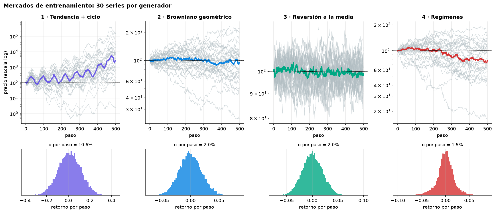
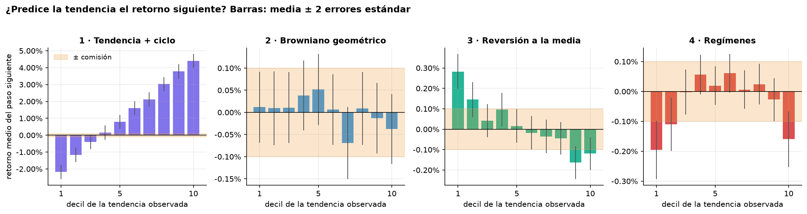
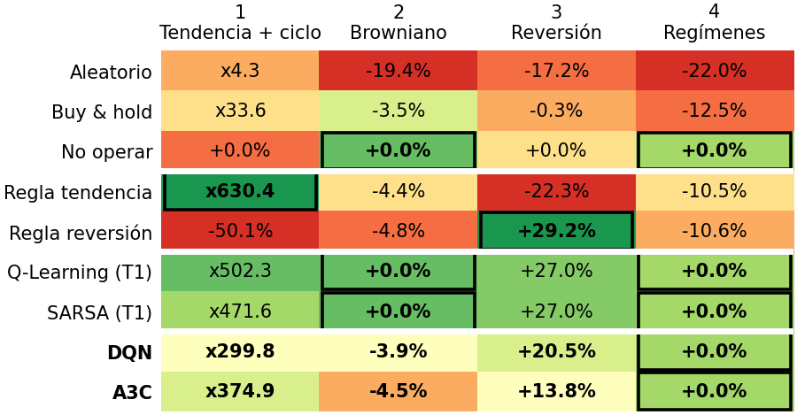
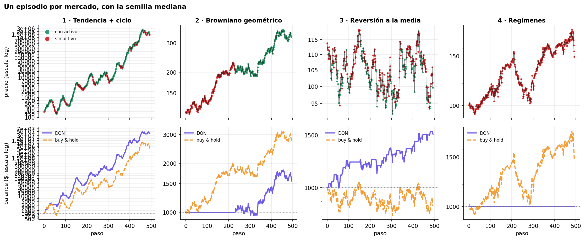
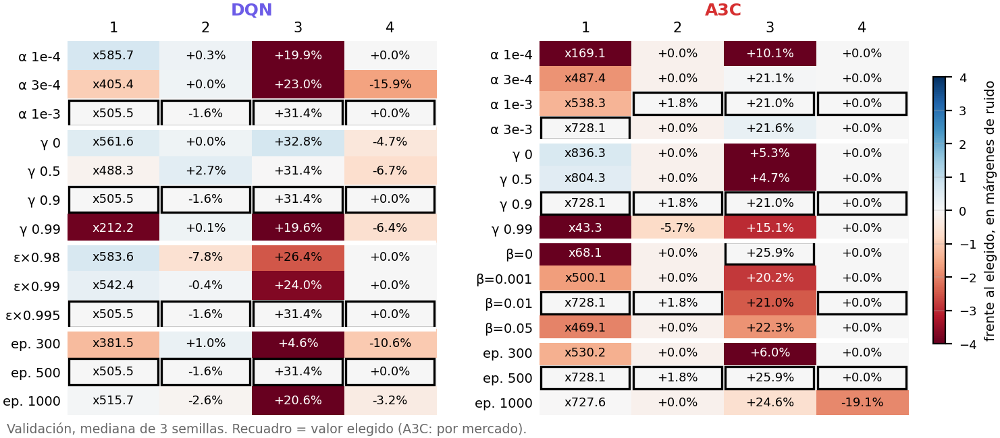
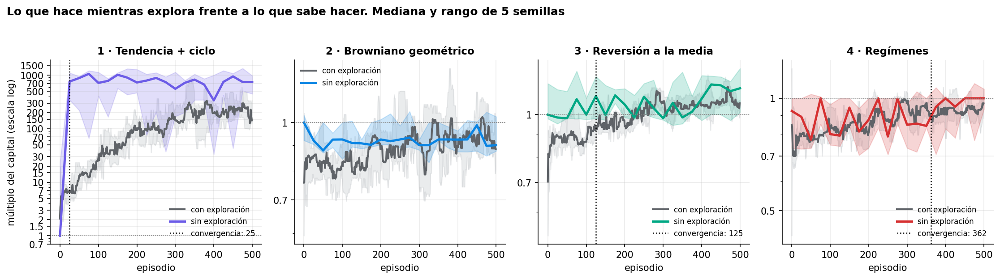
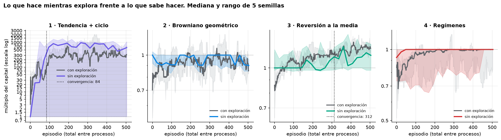
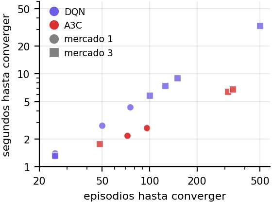
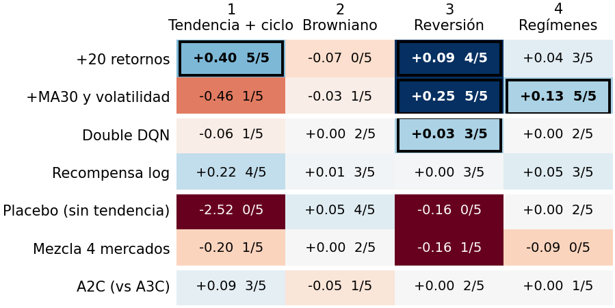

<!-- Fuente del informe. Cifras de results/*.csv y notebooks/04_comparativa.ipynb.
     PDF: python results/build_informe.py --png -->

# Agentes de Deep RL para trading de un activo

Óscar Romero Quincoces · Fernando Dapena Tauste · Daniel García López · Máster MIAX · Aprendizaje por Refuerzo · Noviembre 2026

## 1. Diseño experimental

<b>Fig. 1.</b> 30 series de 500 precios por generador (arriba) e histograma de retornos por paso (abajo).

**Entorno.** `SimpleTradingEnv` del enunciado, sin cambios: estado `(tendencia, posición)`, donde la tendencia es la distancia del precio a su media de los últimos 5 pasos; acciones vender / mantener / comprar (todo o nada); comisión del 0,1 % y recompensa igual a la variación del precio con posición abierta menos costes.

**Mercados.** (1) tendencia + ciclo senoidal con ruido muy alto (σ = 10,6 % por paso); (2) browniano geométrico casi sin deriva (σ = 2 %); (3) reversión a una media de 100; (4) regímenes alcista / bajista que cambian con probabilidad 0,02 por paso. Cada episodio de entrenamiento usa una **serie nueva**, así el agente no memoriza un camino de precios. En el 1 hay ciclos y deriva positiva (buy & hold ya hace x33); en el resto la volatilidad es ~2 % y el precio apenas se desplaza.

- **Protocolo.** Series de 500 precios (494 pasos operables). Ajuste en 100 series de validación; **test en 200 series, evaluadas una sola vez** con la política greedy y 5 semillas. Son las mismas series del Taller 1, por lo que DQN y A3C se comparan directamente con Q-Learning y SARSA. El final de la serie se trata como terminal en los dos algoritmos.
- **Redes.** Lo más simples posible, en PyTorch (evaluar un estado cuesta 0,3 ms frente a 276 ms con `predict` de Keras): entrada `[tendencia/σ, posición]` → 64 ReLU. **DQN:** salida de 3 valores Q, memoria de 20 000 transiciones (unos 40 episodios), lote de 128, un paso de gradiente cada 4 y copia de la red objetivo cada 500. **A3C:** cabezas de política y valor sobre la misma capa, 3 procesos asíncronos que escriben sin cerrojos sobre pesos y Adam compartidos, retornos de hasta `t_max` = 20 pasos y el mismo número total de pasos de entorno que DQN (≈247 000).

- **Normalización.** La tendencia apenas varía (σ = 0,153 en el mercado 1 y 0,024 en el resto) y la recompensa es del orden de 10⁻³, así que ambas se dividen por su σ calculada **solo con series de train**. Sin ella, DQN no opera en reversión (+2,3 % frente a +31,4 % en validación). Las métricas se calculan siempre con el balance real.
- **Métricas.** Mediana del retorno sobre las series (robusta a los x1000 del mercado 1); además Sharpe, drawdown y operaciones. **Convergencia:** primer episodio en el que la curva greedy de validación recorre el 90 % del camino hasta su nivel final; si el agente acaba sin operar o peor que al empezar, no cuenta como convergido.
- **Ajuste con margen de ruido.** Un hiperparámetro cada vez y por mercado. Un valor solo sustituye al actual si mejora más que unos 2 errores estándar de la mediana: 25 % del múltiplo en el mercado 1, 2 puntos en el 3 y 10 en el 2 y el 4. Sin margen, en los mercados sin señal se elegiría el azar más favorable. El orden es red objetivo, α, γ, ε (o β) y episodios.

<b>Fig. 2.</b> Retorno del paso siguiente por decil de tendencia (media ± 2 e.e.); franja = comisión.

**Estrategia esperada.** La tendencia predice el siguiente retorno **a favor** en el mercado 1 y **en contra** en el 3; en el 2 y el 4 el efecto no cubre la comisión. Lo óptimo es seguir la tendencia en 1, comprar caídas y vender subidas en 3 y **no operar** en 2 y 4. Por eso, además del aleatorio y de buy & hold, usamos como referencia **no operar** y dos **reglas de un solo umbral** (tendencia y reversión) elegido en validación: son el listón real, ya que en test baten a los tabulares del Taller 1 (x630 frente a x502 en el 1; +29,2 % frente a +27,0 % en el 3). Un buen agente debería igualarlas.

## 2. Resultados por mercado

<b>Fig. 3.</b> Mediana del retorno en test (200 series; DQN y A3C, mediana de 5 semillas). Color = posición dentro del mercado; recuadro = mejor.

- **Ningún agente de deep RL gana en ningún mercado.** El mejor es siempre una regla de un umbral (x630,4 en tendencia, +29,2 % en reversión) o no operar (0 % en browniano y regímenes).
- Donde hay señal **baten con claridad a buy & hold** (x33,6 y −0,3 %) y al aleatorio, que pierde en todos salvo el 1.
- **Q-Learning y SARSA del Taller 1 quedan por encima** (x502,3 y +27,0 %): con dos variables, una tabla discretizada basta y la red no aporta capacidad útil.
- **Mucha dispersión entre semillas:** en el mercado 1, DQN va de x228 a x558; una semilla de A3C no opera. El Sharpe por paso confirma el orden: 0,201 la regla, 0,169 DQN y 0,176 A3C.
- **En browniano y regímenes no hay nada que ganar:** lo mejor es 0 % y todas las estrategias activas pierden. Que DQN y A3C acaben en 0 % en regímenes es un acierto; en el browniano se quedan dentro y pierden lo mismo que buy & hold.

<b>Fig. 4.</b> Un episodio de test por mercado con la semilla mediana del DQN: posición (arriba) y balance frente a buy & hold (abajo).

**¿Aprende la estrategia esperada?**

- **1 · Tendencia:** sí, compra con tendencia positiva y vende al girar, pero opera de más (53 operaciones por episodio).
- **3 · Reversión:** sí, compra tras caídas y vende tras subidas, la misma lógica que la regla de reversión.
- **2 · Browniano:** no. Entra y se queda (como buy & hold, −3,9 %): en retornos simples mantener tiene esperanza ligeramente positiva, pero con σ = 2 % el capital compuesto pierde.
- **4 · Regímenes:** DQN prácticamente no opera (0 %, frente a −12,5 % de buy & hold), lo correcto. A3C tampoco opera en ninguna semilla. En conjunto, la política aprendida coincide con la del análisis de la Fig. 2 en tres de los cuatro mercados.

## 3. DQN frente a A3C

<b>Fig. 5.</b> Mediana en validación de cada valor probado (3 semillas); color = diferencia con el elegido en márgenes de ruido; recuadro = elegido.

**DQN:** α = 10⁻³, γ = 0,9, ε de 1 con decaimiento ×0,995 por episodio (acaba en 0,08) y 500 episodios. **Ningún cambio supera el margen**, así que se queda la configuración de partida; γ = 0,99 es claramente peor (x212 y +19,6 %).

**A3C** no tiene ε: explora porque su política es estocástica, así que el ajuste de ε se traslada al **coeficiente de entropía β**. Solo superan el margen α = 0,003 en el mercado 1 (x538 → x728) y β = 0 en el 3 (+21,0 → +25,9 %). γ = 0,99 hunde el 1 a x43; enmascarar acciones redundantes y pasar a 1 000 episodios no ayudan.

**Lo decisivo** en ambos es γ y normalizar la entrada: con γ alto el agente valora demasiado un futuro que la tendencia de 5 pasos no puede predecir. El resto de parámetros cambia el resultado menos que la diferencia entre semillas.

<b>Fig. 6.</b> Curva con exploración (gris) frente a la greedy en validación (color), mediana y rango de 5 semillas: DQN arriba, A3C abajo.

**Exploración frente a lo aprendido.** En el 1 la greedy de DQN alcanza su nivel en 25 episodios, mientras la curva con exploración sigue muy por debajo: ε le hace operar al azar casi todo el entrenamiento. En A3C las curvas están más próximas porque explora muestreando su política, pero la banda es más ancha. En el 4 ambas greedy quedan planas en 0: aprenden pronto a no operar.

**Inestabilidad más que falta de capacidad.** A3C cae de x728 en validación a x374,9 en test. Quedarse con el **mejor punto de validación** lo sube a x480,3 y +30,1 % en 400 series nuevas (DQN, x356,7 y +29,6 %), aún por debajo de las reglas (x530,2 y +32,7 %). Se midió tras ver el test: es informativo. En DQN, Double DQN, recompensa logarítmica y la media de 5 redes no superan el margen.

| Mercado 1 · 3 | DQN | A3C |
|---|---:|---:|
| Test (mediana) | x299,8 · **+20,5 %** | **x374,9** · +13,8 % |
| Convergen | **5/5 · 5/5** | 4/5 · 3/5 |
| Episodios | **25 · 125** | 84 · 312 |
| Segundos | **1,4** · 7,5 | 2,4 · **6,4** |
| Entreno total | 33,0 s | **9,9 s** |

{.small}

<b>Fig. 7.</b> Episodios frente a segundos hasta converger, por semilla (tiempos en el mismo equipo).

**Lectura:** rendimiento **empatado** (en el 1 la diferencia cae en el margen; DQN gana en el 3). A3C es **x3,4 más rápido por episodio**, (3 procesos; un gradiente cada 20 pasos, no un lote cada 4), pero DQN converge en menos episodios y en todas las semillas: **hasta converger tardan igual**.

## 4. Más allá de los mínimos

<b>Fig. 8.</b> Ventaja log emparejada frente al DQN base en 400 series nuevas (mismas series y semillas), con semillas que mejoran; recuadro = supera el margen. Experimentos posteriores al test, de un solo cambio cada uno: no sustituyen al resultado oficial.

- **Lo que ve el agente pesa más que el algoritmo.** Añadir los 20 últimos retornos lleva el 1 de x348 a x548 (5/5 semillas); media móvil de 30 y volatilidad llevan el 3 de +16,8 a +47,9 % y el 4 de −7,0 a +7,6 %.
- **Las mejoras de arquitectura apenas aportan:** Double DQN solo mejora en reversión (3/5); dueling, sin red objetivo o recorte de recompensa, nada. A2C no mejora a A3C.
- **Controles:** sin la variable de tendencia (placebo) solo compra y mantiene; mezclar los 4 mercados en un agente empeora la reversión de +16,8 a +0,1 %.
- **Comisión 0 / 0,1 / 0,5 %:** en reversión pasa de 69 a 26 y a 1 operación.
- **Otros mercados:** con tendencia persistente gana +101,5 % frente a +17,5 % de buy & hold; con saltos se queda plano (−0,2 %) y evita el −22,7 % de buy & hold.
- **S&P 500 real** (train 2017–21, test 2024–25): +12,1 % frente a +43,8 % de buy & hold; entrenar con datos reales no da una estrategia mejor que la sintética (+34,8 %).

## 5. Análisis crítico y conclusiones

**Limitaciones**

- **Estado de 2 variables:** limita más que el algoritmo. La tendencia de 5 pasos no ve la volatilidad del 4 ni la persistencia del 1, y con ella una tabla basta.
- **5 semillas y márgenes descriptivos**, no tests de significación; la dispersión entre semillas iguala a las diferencias entre algoritmos.
- **El test ya se había visto** al probar mejoras: esas cifras se miden aparte, en series nuevas, y no cambian la tabla oficial.
- **Recompensa en retornos simples**: no es el logaritmo del capital, y explica que en el browniano compense quedarse dentro.
- **Mercados sintéticos** y un S&P 500 de una única trayectoria, sin dividendos, spread ni deslizamiento. A3C no es reproducible bit a bit.

**Conclusiones**

1. DQN y A3C **aprenden la estrategia esperada** donde hay señal (1 y 3) y **no operan** en regímenes; en el browniano se comportan como buy & hold.
2. **No superan a reglas de un umbral ni a los tabulares**: el problema, con este estado, es demasiado simple para que la red aporte.
3. **DQN ≈ A3C** en rendimiento; A3C entrena 3,4 veces más rápido, DQN converge en menos episodios y con menos varianza entre semillas.
4. El ajuste apenas importa salvo γ y la normalización; **lo que más mejora es enriquecer el estado** (retornos, volatilidad), más que cambiar de algoritmo.

Código, notebooks y resultados: <a href="https://github.com/Romequinco/deep-rl-trading-agents">github.com/Romequinco/deep-rl-trading-agents</a>

